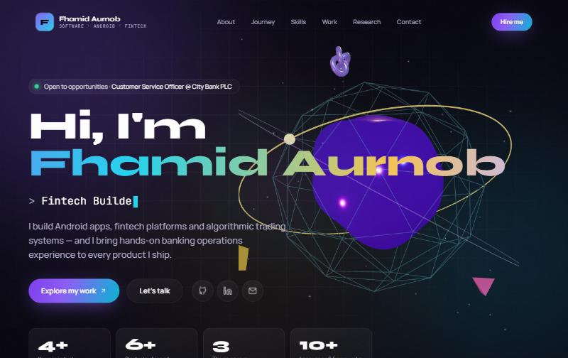

<div align="center">

# 🌌 Fhamid Mottaki Aurnob · 3D Portfolio

**An interactive 3D developer portfolio with animated scenes, live GitHub data and a single-file content system.**

<a href="https://fhamid.netlify.app"></a>


<a href="https://fhamid.netlify.app"></a>

</div>

## ✨ Highlights

- **3D hero scene** built with React Three Fiber: a glowing core, wireframe globe, orbit ring and floating shapes, lazy-loaded so the page stays fast
- **Rotating 3D Earth** in the contact section and a **starfield** background
- **Typing role headline** and animated stat counters (years of experience update automatically)
- **Career timeline** with vertical timeline cards for jobs and education
- **Project gallery** with category filters (Mobile, Fintech, Trading), tilt-on-hover cards and custom artwork per project
- **Live GitHub feed** that pulls my most recently pushed repositories from the GitHub API
- **Research section** for my published thesis papers
- **Scroll-triggered animations** with Framer Motion, and a responsive layout that simplifies 3D on mobile

## 🧱 Tech stack

| Area | Tools |
|---|---|
| UI | React 18, React Router, Tailwind CSS |
| 3D | Three.js, React Three Fiber, Drei, glTF models |
| Motion | Framer Motion, react-parallax-tilt, react-vertical-timeline-component |
| Build & deploy | Vite, ESLint, Netlify |

## 📁 Project structure

```
src/
├── components/         # Hero, About, Experience, Tech, Works, Research, Contact…
│   └── canvas/         # 3D scenes: HeroScene, Earth, Stars
├── constants/index.js  # ALL site content: profile, skills, jobs, projects, research
├── hoc/                # Section wrapper with scroll animations
├── hooks/ · utils/     # Helpers (media queries, motion variants)
└── App.jsx
public/                 # 3D models (desktop PC, planet)
```

## 🚀 Run locally

```bash
npm install
npm run dev       # start the dev server
npm run build     # production build to dist/
```

## ✏️ Update content

Every piece of text on the site (profile, roles, stats, skills, experience, projects and research) lives in **`src/constants/index.js`**. Edit that one file and every section updates.

## 🌐 Deploy

Netlify builds automatically from `main` with `npm run build` and publishes `dist/` (see `netlify.toml`).

## 📬 Contact

**Fhamid Mottaki Aurnob** · [Portfolio](https://fhamid.netlify.app) · [LinkedIn](https://www.linkedin.com/in/fhamid-aurnob-115a8915a) · [GitHub](https://github.com/FhamidAurnob)

<sub>3D models in `public/` are used under the licenses included in their folders.</sub>
